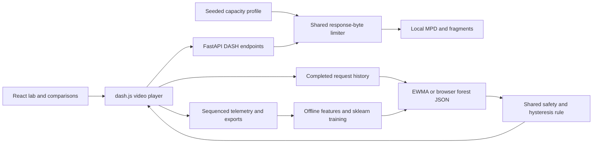

# StallGuard — Network-Aware Adaptive Video Streaming

StallGuard is a local Computer Networks lab for watching how changing delivery capacity affects real MPEG-DASH playback. It compares historical EWMA adaptation, a trained random forest and dash.js default ABR. Each run records actual requests, throughput, buffer state, playback and quality transitions.

Computer Networks is central: FastAPI paces actual HTTP response bytes through a shared per-session budget, including concurrent audio/video and range requests. Capacity profiles change during transfers. This is application delivery shaping; it does not simulate packet loss, RTT or TCP congestion control. ML forecasts the next request's effective throughput from causal observations. Data Science supplies grouped training/validation, parity checks and matched comparisons.

## Implemented features

- Real 120-second local DASH video: four aligned H.264 resolutions, shared AAC audio and two-second video segments.
- Stable, drop/recovery, gradual, correlated fluctuating and unfamiliar capacity profiles, deterministic seeds and capacity scaling.
- Shared EWMA/ML controller with buffer safety and hysteresis; genuine dash.js default rules as comparator.
- A real 32-tree scikit-learn forest exported as JSON for synchronous browser inference, with checksum, provenance and visible EWMA fallback if unavailable.
- Sequenced telemetry, stop/save, natural-end detection, partial-session recovery, JSON/CSV exports and comparison compatibility checks.
- Responsive Playback Lab, Compare Sessions and How It Works tabs, CSS 3D buffer visualization, reduced motion and low effects.

## Stack and verified environment

React 19, TypeScript, Vite 6.1 and dash.js 5.0.3; Python/FastAPI/Uvicorn; NumPy, pandas and scikit-learn; FFmpeg/FFprobe; pytest, Node tests and Playwright. Direct Python dependencies are pinned in `requirements.txt`; frontend resolution is locked by `frontend/package-lock.json`.

Original audit: Windows, Python 3.13.5, Node 20.19.4, Chrome 155.0.8059.85. See [publication verification](docs/PUBLICATION.md) for fresh staging-checkout outcomes. macOS/Linux and other browsers are unverified.



## Fresh setup and launch — Windows PowerShell

Install Python 3.13, Node 20.19+ and Chrome. Initial installation needs internet to obtain dependencies and encoding tools. Prepared local operation needs no internet, API key, paid API or hosted inference service.

```powershell
git clone https://github.com/Trunal2005/CN-G12-Project-Link.git
cd CN-G12-Project-Link
python -m venv .venv
.\.venv\Scripts\python.exe scripts/setup.py
.\.venv\Scripts\python.exe scripts/doctor.py
.\.venv\Scripts\python.exe scripts/run.py
```

Open **http://127.0.0.1:8000/** in Chrome. Select a policy/profile and start a session. Stop & save ends a bounded run; natural completion is recorded separately. Ctrl+C stops the server. `scripts/run.py --port 8001` selects another port; experiment commands must use the matching URL.

Using the venv executable directly avoids PowerShell activation policy issues. Setup installs Python dependencies, runs `npm ci`, prepares missing media and builds the frontend. It obtains FFprobe from `ffprobe-static` if not on PATH; this is a large initial download. FFmpeg comes from `imageio-ffmpeg` unless available on PATH. No Docker, GPU or administrator installation is required. For development, run Uvicorn on port 8000 and `npm --prefix frontend run dev` in another terminal.

## Media and model preparation

Generated media and encoding binaries are deliberately excluded. Setup automatically creates a 120-second FFmpeg `testsrc2` + sine calibration clip, with no external footage. FFprobe verifies actual encoded resolutions; the inventory verifies segment alignment and sizes.

```powershell
.\.venv\Scripts\python.exe scripts/prepare_media.py --verify-only
# Explicit replacement outside experiments:
.\.venv\Scripts\python.exe scripts/setup.py --regenerate-media
```

The fresh publication setup produced media that differs byte-for-byte from the originally evaluated bundle. Original and new fingerprints are recorded in the publication checks; new sessions compute their own identity. Never relabel old results as results on regenerated bytes.

`data/models/forest.json` and `parity.json` are included for inference and numerical checks. The model was fitted on six training sessions (143 rows), validated on two separate sessions (53 rows), with 32 trees, depth 6, minimum leaf 3 and seed 731. JSON records feature order, float32 threshold semantics, hyperparameters, source export hashes and metrics. Eight small collection exports reproduce training. Joblib is unnecessary for browser operation and is excluded; never load untrusted pickle/joblib files.

To refit deliberately, back up model files first. The default command selects the included historical collection and replaces model/parity artifacts:

```powershell
.\.venv\Scripts\python.exe ml/train.py
```

For new data, leave the server running, choose a fresh output folder and explicitly select it for training:

```powershell
.\.venv\Scripts\python.exe scripts/experiments.py collect --seconds 34 --out data/experiments/collection-001
.\.venv\Scripts\python.exe ml/train.py --collection-dir data/experiments/collection-001
```

Do not retrain during a matched comparison. Missing/invalid models visibly fall back to EWMA; those runs are not ML evidence.

## Verification and experiments

After setup:

```powershell
$env:PYTEST_DISABLE_PLUGIN_AUTOLOAD = '1'
.\.venv\Scripts\python.exe -m pytest tests -q
npm --prefix frontend test
npm --prefix frontend run build
```

With the server running and no other playback:

```powershell
.\.venv\Scripts\python.exe scripts/publication_smoke.py --base-url http://127.0.0.1:8000 --out data/publication-smoke
.\.venv\Scripts\python.exe scripts/audit_experiments.py transport --base-url http://127.0.0.1:8000 --out data/experiments/repeat-001
.\.venv\Scripts\python.exe scripts/audit_experiments.py matrix --base-url http://127.0.0.1:8000 --out data/experiments/repeat-001 --seconds 40 --repetitions 3
.\.venv\Scripts\python.exe scripts/audit_experiments.py full --base-url http://127.0.0.1:8000 --out data/experiments/repeat-001
```

Each experiment phase refuses to overwrite an existing phase directory. Matrix writes raw per-run exports plus `matrix/runs.json` and `runs.csv`: three policies × three profiles × three repetitions. Full waits for native ended. Browser runners use installed Chrome and block external requests. A four-profile evaluation is also available through `scripts/experiments.py evaluate --out data/experiments/evaluation-001 --seconds 40 --repetitions 1`.

`scripts/report.py`, `audit_analysis.py`, `audit_freeze.py` and `audit_compare.py` retain the original workstation audit workflow and its assumptions. They require omitted archives/raw audit sessions or regenerated trusted joblib artifacts and are not fresh-clone preflight commands. Use the commands above for new evidence and UI exports for comparisons. See [publication notes](docs/PUBLICATION.md).

## Measured results and limits

The repaired-app audit ran **27 matched 40-second experiments**, three repetitions per policy/profile. All policies were stall-free. On 525 causal held-out rows, forest MAE was **0.463 Mbps**, versus EWMA **0.353 Mbps**; forest RMSE was **0.622 vs 0.663 Mbps**. ML did not demonstrate overall superiority. All 179 recorded runtime forest predictions matched sklearn. Separate natural-end checks reached 120 seconds and decoded 2,880 frames; these are not 27 full-length benchmarks.

See the [matched results](data/audits/20261020T142828Z/analysis/RESULTS.md), [audit report](docs/AUDIT_REPORT.md) and [historical results](docs/RESULTS.md). Compact summaries preserve original source/media/model identities. Large raw audit session stores, baseline archives and original media remain local; public evidence is a subset of the full forensic archive. Fresh clones have empty comparison history: create new runs before presenting the live comparison page.

This is a single-host synthetic prototype. No WAN, loss, wireless interference, perceptual-quality or Internet-wide superiority claim is supported. Bounded runs, small older training data and distribution shift limit conclusions. Hard kills may lose an unflushed telemetry tail. Vite reports a large dash.js chunk. No project license has been assigned; see [attribution](docs/ATTRIBUTION.md).

## Repository structure

```text
backend/app/       API, byte limiter, profiles, telemetry and summaries
frontend/src/      React UI, dash.js, ABR and forest inference
ml/                causal features and sklearn training/export
scripts/           setup, doctor, generation, launch and evaluation
tests/             backend, lifecycle, identity and feature tests
data/models/       browser forest and numerical parity vectors
data/results/      historical training inputs and compact results
data/audits/       compact repaired-app evidence and plot
media/             generated locally by setup (not committed)
docs/              methodology, architecture, demo and viva
```

Read [architecture](docs/ARCHITECTURE.md), [methodology](docs/METHODOLOGY.md), [research](docs/RESEARCH.md), [results](docs/RESULTS.md), [demo](docs/DEMO.md), [professor walkthrough](docs/PROFESSOR_DEMO.md), [viva](docs/VIVA_VERIFIED.md), [page map](docs/PAGE_MAP.md), [status](docs/STATUS.md) and [publication verification](docs/PUBLICATION.md).
