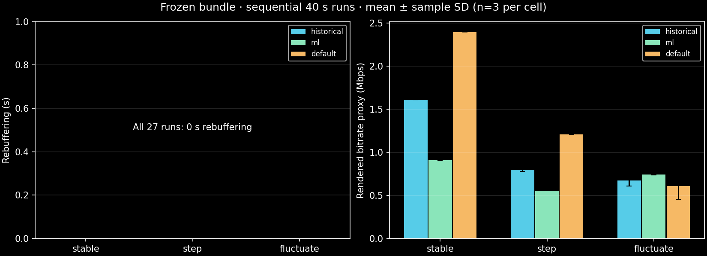

# Publication scope and reproducibility

Prepared from the existing StallGuard workspace in a separate clone of `Trunal2005/CN-G12-Project-Link`, preserving the destination's initial `main` commit. The original source, generated media, full session stores and forensic archives remain untouched in the original workspace. Publication changes are confined to this checkout.

## Included artifacts

- Backend/frontend/ML source, package lock, requirements, tests and preparation/evaluation scripts.
- Browser forest JSON, parity vectors and all eight historical training/validation exports. Their raw SHA-256 values match forest provenance. These small synthetic inputs are necessary to reproduce the fitted estimator and feature checks.
- Historical compact result tables, collection manifest and original evaluated-media hashes.
- Repaired-app 27-run matrix summaries/CSV, aggregate results/plot, real request trace, counter corrections, transport/media/model checks, final natural-end and UI check summaries. Paths are under `data/audits/20261020T142828Z`.

## Deliberately excluded

Environments, node_modules, build output, caches, logs, encoder/browser binaries, temporary downloads, large raw audit/session stores, baseline ZIP archives, generated media and joblib artifacts are excluded. No Git LFS, paid hosting or API keys are used. Fresh setup recreates media and the frontend build; the browser forest is already included. `ml/train.py` can regenerate trusted joblib/parity/model artifacts from the included collection. An explicit `--collection-dir` selects a new collection rather than silently reusing historical data.

FFmpeg generates synthetic motion and sine content; no external footage is bundled. See [attribution](ATTRIBUTION.md). Fresh media can have different bytes/hashes from the measured bundle. Compare only newly matched runs with the same recorded source/media/model/settings identities. Publication adds training collection selection; the historical measured source identity is preserved rather than relabeled.

The audit documents describe the original prepared workstation and its archived history. That entire history is not preloaded on a new clone. The professor script's saved three-row comparison must be recreated by running experiments locally, or explained using the included static measured table. Older source snapshots, original historical evaluated media and raw 27-run request dumps are not in the public subset. Consequently the legacy audit freeze/analysis/report/comparison scripts cannot reconstruct every original forensic step from this subset alone. The supported fresh evaluation runner writes new complete raw exports and summaries without overwriting the published evidence.

## Fresh checkout verification

Publication checks and their actual outcomes are recorded in [publication-checks.json](../data/publication-checks.json). The fresh installation uses its own `.venv`, node_modules, regenerated media and build within the staging checkout. Browser smoke uses that checkout's server on port 8003 while the original workstation server remains independent. Requests outside localhost are blocked in the browser check. This tests offline prepared application requests, not OS-wide airplane mode.

Executed on 21 October 2026: fresh setup passed; isolated `pip check` passed; 16 Python tests passed; 7 TypeScript tests passed, including 124 exported model parity vectors; production build, doctor and read-only media verification passed. Chrome UI playback reached 3.025 seconds / 77 decoded frames, made two forest decisions, then Stop & save produced a cancelled session and Export JSON downloaded a valid matching export. Desktop/mobile screenshots were inspected; no overflow, page errors, failed HTTP statuses or external requests occurred. This is a short publishing smoke, not a new performance benchmark. The Starlette/AnyIO deprecation and Vite large-chunk warnings remain non-blocking.

The staging-generated media fingerprint is `bundle-v2:d84fe35eafdb559fc16c0225593848d98076739c1d5e664e91ecb92d65b67d06`, different from the measured `bundle-v2:ff3bf778eca735432709c7cbed130ece84a685a386229bf6bd291f2bc6ca1360`. The included model and training exports retain their exact original hashes. Repository attributes prevent Git line-ending conversion of evidence; staged blob hashes were checked directly. Full raw logs, generated media, screenshots and tools used for this fresh check remain untracked locally.

No new benchmark or model fit was performed solely to publish. Earlier evidence remains dated and scoped: 16 Python and 7 TypeScript tests; 27 bounded matched runs with zero stalls; separate 120-second natural-end checks; forest MAE worse than EWMA. See [audit report](AUDIT_REPORT.md). Publication does not turn these into Internet-wide claims.

Non-Windows platforms, other browsers, actual network loss/RTT/TCP-control and perceptual quality remain untested. Python direct dependencies are pinned; transitive Python packages are resolved by pip at installation time. The frontend lock fixes its dependency graph. Vite's large dash.js chunk warning remains.
